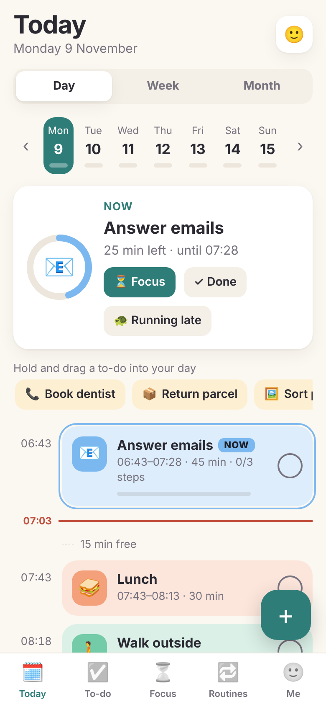
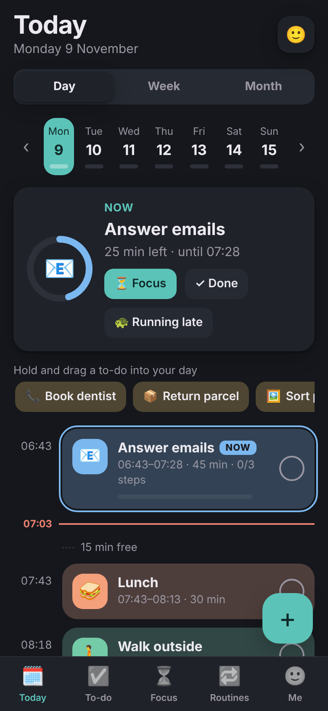
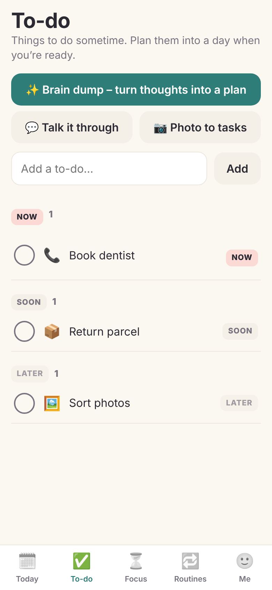
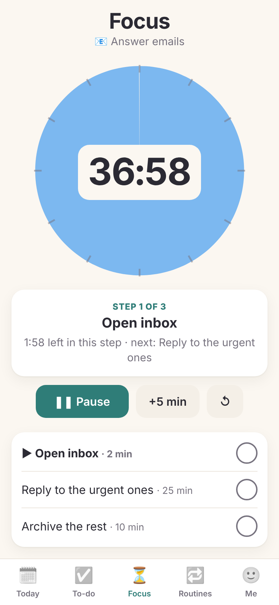

# Pacely

**A calm, visual day planner for ADHD, autistic and AuDHD brains. Free, open source and private: your plans stay on your own devices.**

No subscription. No ads. No tracking. No analytics. No account with anyone.

> **Made by a human and an AI, together.** Pacely was designed and directed by **Sam Fox**, who is AuDHD himself,
> and written with **Claude**, Anthropic's AI assistant, in conversation. Sam set the goals, tested it on his own
> phone, watch and computers, and made the decisions; Claude wrote the code, tests and guides. AI-written commits
> are marked *Co-Authored-By: Claude*.

## Pick how you want to use it

| | | |
|---|---|---|
| 🌐 | **In your browser.** Windows, Mac, Chromebook, Linux. Plans are kept in the browser on your device. | **[Open Pacely](https://samfox84.github.io/Pacely/)**, then **Install** in Chrome or Edge |
| 📱 | **iPhone, just this phone.** No server. Plans stay on the iPhone. | **[iPhone guide](ios/README.md)** |
| 💻 | **Mac app** with a menu bar countdown and calm pop-ups. On the Mac, or with your server. | **[Mac guide](mac/README.md)** |
| 🏠 | **Your own Pacely server**, so your phone, watch and computers all share one plan, and family can help. An old laptop, Raspberry Pi or home server is plenty. | **[Server guide](docs/setup-server.md)** |

New to Pacely? **[How to use it](docs/using-pacely.md)** is a short, calm tour.
What's new: [CHANGELOG](CHANGELOG.md). Pacely is still early, so versions are 0.x.

Moving between them is easy: **Save a copy** makes one file with all your plans, and **Load a file** lets you
**merge** it with what you have or **replace** everything.

## Designed to be calm

Pacely follows published guidance on designing for autistic and ADHD people
([UK Home Office](https://ukhomeoffice.github.io/accessibility-posters/autism),
[W3C cognitive accessibility](https://www.w3.org/TR/coga-usable/)) and what we learned from using it every day:

- **Little on screen at once.** A *Calm layout* shows one line for the day, what's happening now, and your timeline.
  Everything else is a tap away.
- **No pressure.** No ticking clocks by default ("until 9:15"), no streaks that reset, and reminders that state
  things plainly ("Starting about now.", "Still here whenever you're ready.") instead of giving orders.
- **You're in control.** Sounds, haptics, movement and every reminder can be switched off. *Low-stimulation mode*
  does it all in one switch, and *Quiet hours* keeps notifications away when you choose.
- **Predictable.** Things stay in the same place, buttons say exactly what they do, colour is soft, and amber
  only appears when something needs you.
- **Easier to read.** Plain words, short sentences, and *Atkinson Hyperlegible* or *OpenDyslexic* fonts if you want them.
- **No blank page.** Routines, templates, *Make a list* and an optional AI helper get you started.

## What it does

- **Visual timeline** with colour blocks sized by time, a now-line and free-time gaps. Day, week and month views.
- **Quick add in plain words**: "dentist tomorrow 9:30", "in the office every tue and thu", "bins tonight".
- **Steps** for any activity, **routines** you can add in one tap, a **to-do list** (Now / Soon / Later) and a **focus timer**.
- **Running late?** One button moves the rest of today back. **Couldn't do it today?** It finds it a new day, no guilt.
- **All-day days** shown as a quiet banner: office days, working from home, days off, sick days, holidays.
- **Make a list** from a long message: one thing per line, quantities first, shopping in supermarket order.
- **Gentle nudges** (optional) to drink, eat and take a pause.
- **Calendars**: show Google, iCloud or Outlook calendars, tidied to your working hours, without repeating blocks or copies of things already in Pacely.
- **iPhone and Apple Watch** (native): widgets, Lock Screen countdown, Dynamic Island, Siri, Control Centre, two-way Calendar sync.
- **Mac** menu bar countdown and gentle pop-ups.

**With your own server you also get:**
- **Family helper.** Send your partner a private one-time invite. They add things to your plan (and lists, like the
  shopping) from their phone, and see what you've chosen to share. Anything marked **Private** stays private.
- **Live sync** between all your devices.
- **When to leave**: add a place and Pacely works out the journey. On office days (in London) it can watch your
  TfL route and tell you, once and calmly, if a delay changes when you need to leave.
- **AI helper (optional, off until you set it up)**: brain dump to tasks, talk it through, photo to tasks,
  *Find it and plan it* (looks up an event online). Runs privately on your own server (Ollama), or with your own
  Google Gemini key. The iPhone's "just this phone" mode can use your own Gemini key too.

## Privacy

- Your plans are kept only where you choose: your browser, your iPhone, your Mac or your own server.
  Nothing is sent to Sam, to GitHub or to anyone else.
- No analytics, trackers, adverts or accounts.
- Outside services are only used for features **you** switch on. [Privacy in detail](docs/privacy.md).

## Good to know

- Pacely is a planning tool, not a medical device or a substitute for professional support.
- It's a personal, community project with no warranty (see the licence).
- Found a security problem? See [SECURITY.md](SECURITY.md). Want to help? See [CONTRIBUTING.md](CONTRIBUTING.md).

## Licence and credits

[GPL-3.0](LICENSE). You're free to use, change and share Pacely. If you share a changed version, it has to stay
free and open source too.

- [ical.js](https://github.com/kewisch/ical.js) 1.5.0 (`server/static/ical.min.js`) by Philipp Kewisch and contributors,
  under the [Mozilla Public License 2.0](https://mozilla.org/MPL/2.0/).
- [Atkinson Hyperlegible](https://www.brailleinstitute.org/freefont/) by the Braille Institute, and
  [OpenDyslexic](https://opendyslexic.org) by Abbie Gonzalez, both under the
  [SIL Open Font License 1.1](server/static/fonts/OFL.txt).
- The sound pack and line icons were made for Pacely; their source scripts are in `tools/` so anyone can change them.

Made by **Sam Fox** ([@Samfox84](https://github.com/Samfox84)) with Claude, for everyone who can't afford another
subscription and doesn't want to be tracked.
